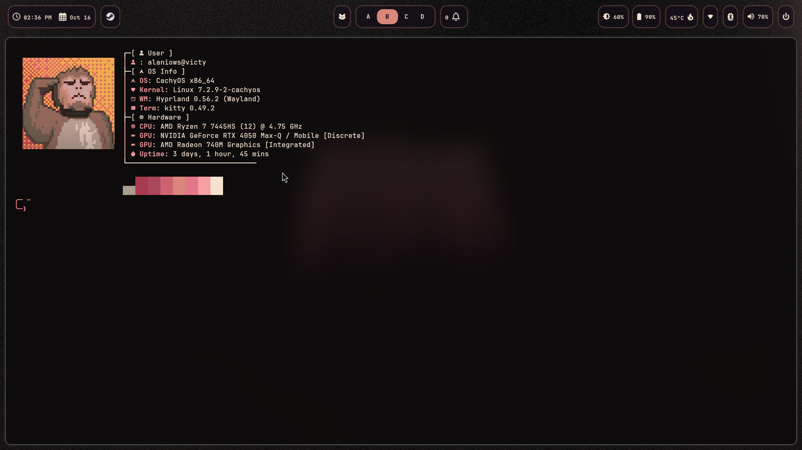
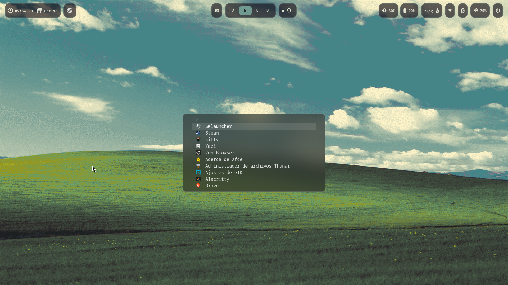
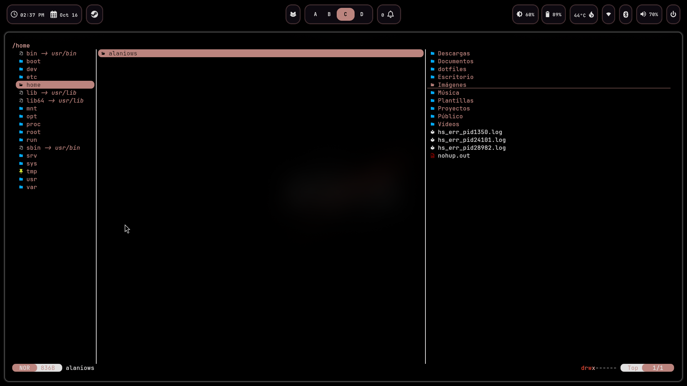
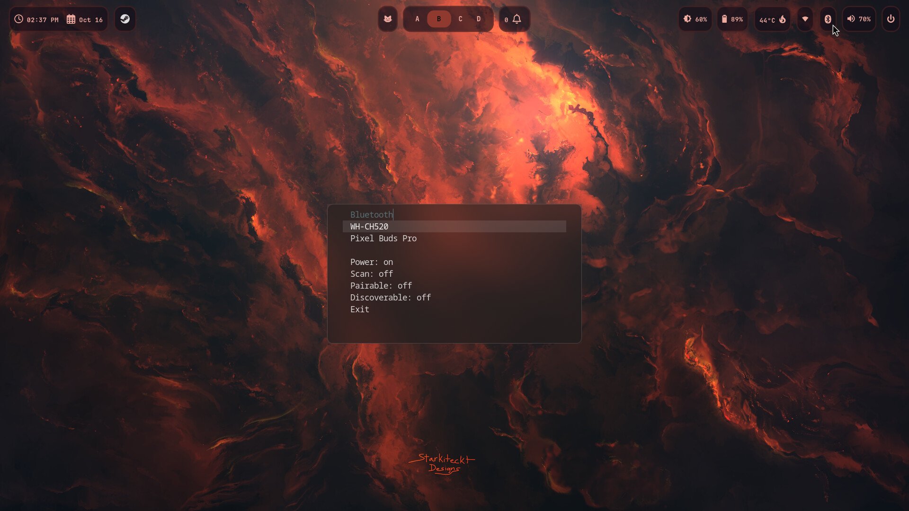
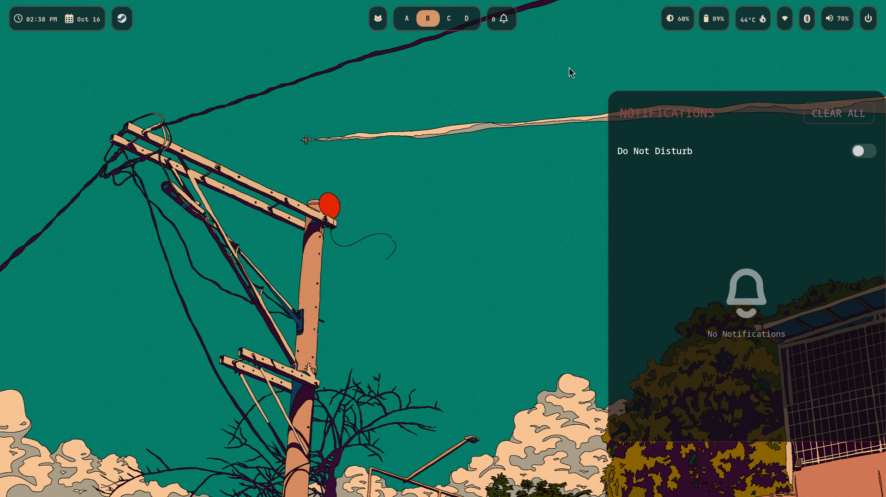

# dotfiles

Hyprland (Wayland) rice on CachyOS (Arch). Managed with GNU Stow.

## Stack
Hyprland · Waybar · Kitty · fuzzel · fish · hyprlock

## Install
    git clone https://github.com/alaniows/dotfiles ~/dotfiles
    cd ~/dotfiles
    stow hypr waybar kitty fuzzel fish

Packages: `packages.txt` (`pacman -Qqe`)

## Screenshots

